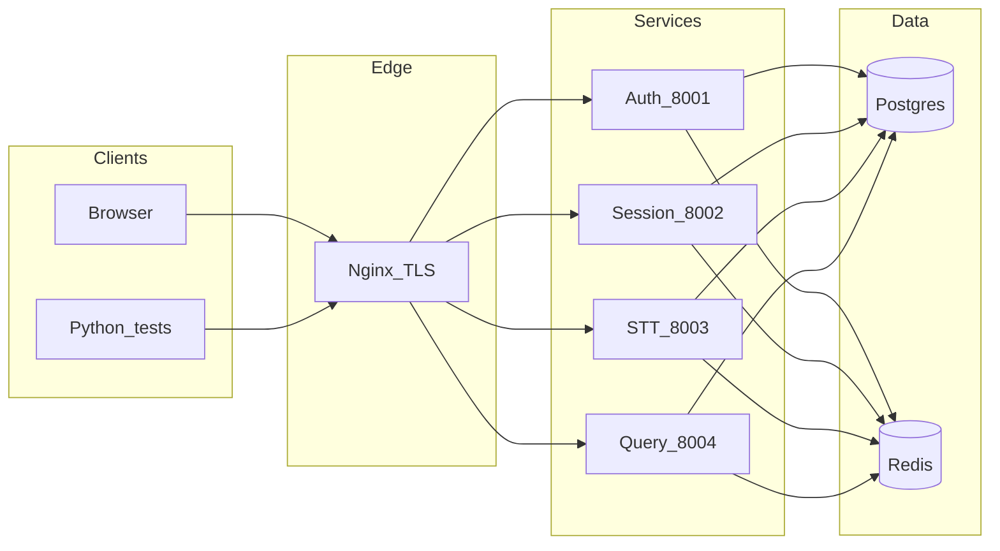

# Architecture, security, and operations

## System architecture

Clients talk to a single TLS entrypoint (`nginx`). It terminates HTTPS, applies rate limits, and proxies to internal services on a Docker bridge network.

**Auth** issues JWT access tokens and http-only refresh cookies, maintains a **JWT blocklist** (logout / password change / admin revoke), and owns enterprise onboarding (teacher/admin invites, audit logs).

**Session** owns courses and class sessions (state machine: live, processing, done, failed), teacher vs admin RBAC, and GDPR-oriented **retention purge** endpoints.

**STT** ingests realtime audio over **WebSocket**, runs ASR/diarization (when using the real image), and uses Redis for streaming coordination.

**Query** serves search and summaries over stored transcripts when the pipeline has produced them.

Migrations run once via the `migrate` compose service (Alembic) before app containers start.

## Security measures (summary)

- **TLS at nginx** — self-signed locally (`scripts/generate_certs.sh`); replace with a public CA in production.
- **RS256 JWTs** — private key only on the auth service; other services verify with the public key.
- **Blocklist** — access tokens can be invalidated server-side after logout, password change, or selective session revoke.
- **RBAC** — super_admin, admin, teacher scopes enforced in session and auth routers; teachers cannot create courses or see other teachers’ data by default.
- **Rate limits** — nginx zones (API / WebSocket) and application-level limits (e.g. login failures) to slow brute force and abuse.
- **Retention** — configurable admin purge for old session data (GDPR storage limitation).

## PFE demo script (suggested narrative)

1. Show **HTTPS gateway** health: `GET /health`.
2. Log in as **super_admin** (seeded in dev via env bootstrap).
3. Create a **teacher invite**, open preview link, **accept** and set password.
4. Log in as **admin** (second invite), **assign a course** to the teacher.
5. Log in as **teacher**, **start session**, optional short recording if real STT is up, **end session**.
6. Call **query** summary endpoint and explain **409/404** until the AI pipeline has run.

## Production and operations checklist

1. **TLS** — Valid certificates on nginx; do not rely on `-k` / disabled TLS verification in clients.
2. **Secrets** — Keep `.env` and `secrets/*.pem` out of git (see [.gitignore](../.gitignore)). Use a secrets manager or encrypted deploy vars in production.
3. **Bootstrap password** — Rotate `SUPER_ADMIN_BOOTSTRAP_PASSWORD` after first deploy if the account was materialized from env.
4. **Model/API keys** — `GEMINI_API_KEY`, `HF_TOKEN` (STT) must be set for real inference; CI uses dummies with the STT **stub** only.
5. **Backups** — PostgreSQL volume backup strategy (point-in-time recovery if required by policy).
6. **Observability** — Services log with structured fields (e.g. `stt_service.models_load_failed`); forward logs to your aggregator and alert on error spikes and repeated health failures.
7. **Resource limits** — The real STT image is memory-heavy; keep compose `deploy.resources` or host limits appropriate; expect long **first** start while models download.

## Running tests locally and in CI

- Full stack (real STT): `docker compose up -d --build` then `bash scripts/run_all_tests.sh` or `.\scripts\run_all_tests.ps1`.
- Fast regression (stub STT): `bash scripts/ci_bootstrap.sh` then `docker compose -f docker-compose.yml -f docker-compose.ci.yml up -d --build`, then the same test scripts.
